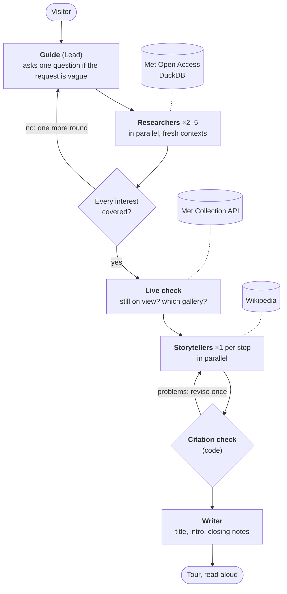

# Docent AI

## Your personal museum guide.

Every museum hides more than any visitor can find. Thousands of objects, hundreds of galleries, and
object labels written for experts leave most people wandering, missing the piece that would have
stopped them in their tracks.

- **The labels are written for experts.** They mention the "Ptolemaic Period" or "cartonnage",
  terms that aren't common knowledge and take some background to understand.
- **Google and chatbots don't know the collection.** The Met has **44,855** objects on view, and
  only **352** have their own Wikipedia article. For the rest, you'd need to read several sources
  to connect the dots.
- **Audio guides and tour guides are one-size-fits-all.** Every visitor's interests differ, yet
  everyone gets the same highlights instead of discovering the pieces that would truly speak to
  them.

**Docent AI gives every visitor a personal docent, starting with The Met in New York City, one of
the largest museums in the world, with about 5.7 million visitors a year.**

It searches all **44,855 objects on view** and plans a tour around your interests and your time,
ordering the stops into a walk that flows from one to the next instead of crisscrossing the
building. It explains every stop in a way you'll understand, meeting you where you are, and reads it aloud as
you walk. Behind it is a team of agents (Gemini 4 Hydrogen through the Gemini API, OpenAI Agents SDK):

- **Guide.** Reads your request, asks a follow-up if it's too vague, and splits the museum into
  slices to research.
- **Researchers** (up to 5, in parallel). Each searches one slice of The Met's Open Access
  collection, loaded into DuckDB, and returns candidates with sourced evidence. If an interest
  isn't covered, the Guide sends them back for a second round.
- **Live check.** Before a stop makes the tour, The Met's Collection API confirms it's still on
  view and in which gallery, and the route is ordered so you don't double back.
- **Storytellers** (one per stop, in parallel). Each pulls from several sources: the object's Met
  record, its own or its artist's Wikipedia article (matched through Wikidata), and background
  articles on its culture, period and materials. It turns them into a 180–250-word story and one
  thing to look for.
- **Writer.** Writes the tour's title, introduction and closing notes.
- **Citation check** (code). Every fact carries a source tag. Code confirms each source was
  actually read in this run and that the names, places and numbers in a sentence appear in the
  source it cites. Anything that fails goes back for one revision.
- **Restorer.** While the stories are written, every stop with a Met photo goes to the Restorer,
  which reads the photo and record and names what has changed since the object was made: broken-off
  parts, missing limbs, lost paint. Nano Banana 2.1 then adds only those parts to The Met's photo.
  Objects that survive whole are left alone. Each reconstruction appears beside The Met's photo with
  a list of what the AI added, and carries a small **AI reconstruction** tag on the image itself.

You can type, **speak** (Gemini 3.5 Transcribe turns your voice into the request) or **snap a
photo** of an object or its label, which the Guide recognizes and finds in the collection. The
finished tour is read aloud with Gemini 3.8 Flash TTS, and a **Behind the scenes** panel streams
each agent's thinking as it happens.

## At a glance

| | |
|---|---|
| **Data** | The Met Open Access (Nov 7, 2026 snapshot) · Met Collection API (live) · Wikidata · Wikipedia |
| **Models** | Gemini 4 Hydrogen (agents) · Nano Banana 2.1 (reconstructions) · Gemini 3.5 Transcribe (voice in) · Gemini 3.8 Flash TTS (voice out), all through the Gemini API |
| **Stack** | OpenAI Agents SDK · DuckDB · FastAPI |

## Who it's for

A curious visitor who is not an art historian: a first-timer with an afternoon, a parent with a
child who loves horses, someone who stops at an object label and wants to know *why it matters*.
They are standing in a gallery, on a phone, and want an answer they can trust and act on.

## How it works



**Agents and their jobs**

| Agent | Job | Tools |
|---|---|---|
| **Guide** (Lead) | Reads the request, asks one question if it is too vague, plans the research slices, picks the stops, handles label lookups and counting questions | `research`, `plan_route`, `write_tour`, `write_answer`, `tell_story`, `find_by_accession`, `find_by_title`, `run_sql`, `search_objects`, `gallery_summary`, `snapshot_info`, `get_object`, `get_wikipedia` |
| **Researcher 1…5** | Each searches one slice of the museum in a fresh context and returns candidates labeled *direct* or *related* to each interest, with sourced evidence | `run_sql`, `search_objects`, `get_object`, `gallery_summary`, `get_wikipedia` |
| **Storyteller 1…n** | One per stop, in parallel: plans what a newcomer won't know, reads background on Wikipedia, writes a 180–250 word story and a "look for". Each stop appears on the page as soon as its story is done; a Storyteller that passes 75 s is stopped and its stop uses the Researcher's cited facts | `get_wikipedia`, `search_wikipedia` |
| **Writer** | Writes only the tour's frame (title, introduction, what the data couldn't tell us) or a short answer | none: evidence only |
| **Citation check** (code) | Checks every `[met:…]`/`[wikipedia:…]` tag was actually read in this run, and that each cited sentence's names and numbers appear in the source it cites | — |
| **Restorer** | For each stop with a photo, names what has changed since the object was made (or says it survives whole); Nano Banana 2.1 then reconstructs only those parts | Gemini API (vision, image generation) |

Every tool takes a required `why`: one sentence the agent writes about why it is making that call,
recorded with each tool call.

### Admitting what the data can't answer

The agent says so plainly for crowds, opening hours, loans and special exhibitions, objects not on
view, and anything a label says beyond the record. Tours open with "The Met has nothing on view that
directly matches *dinosaurs* (in its collection data of Nov 7, 2026)…" when an interest isn't
covered, and every tour ends with what the data could not tell us.

**Known limits**

- **Walking times** come from a simple model of the building (galleries grouped into wings and
  floors), not a floor plan.
- **Paraphrase:** the citation check catches names and numbers pinned on the wrong source, not a
  reworded over-claim.
- **Time-limited stops:** a stop whose Storyteller hits the 75 s limit shows the Researcher's facts
  instead of a full story, and those aren't re-checked.
- **The voice** is a generative model: it can stop early on a long paragraph. The page detects audio
  that is too short for its text and reads the rest again from one sentence before the cut.

## Data

| Source | What it gives | When |
|---|---|---|
| [The Met Open Access CSV](https://github.com/metmuseum/openaccess) (`MetObjects.csv`, 340 MB) | Every object's record; a gallery number means it is on view | Offline build; data as of **Nov 7, 2026** |
| [The Met Collection API](https://metmuseum.github.io/) | Image links (public-domain works only), and at tour time, whether each stop is still on view and where | Offline crawl (Nov 10) and live, per tour |
| [Wikidata](https://www.wikidata.org/) | Which English Wikipedia article each object and artist has (via the Met's Wikidata IDs) | Offline build |
| [Wikipedia](https://en.wikipedia.org/) REST and search APIs | Background articles the Storytellers read | Live |

The built database, `data/met.duckdb` (14 MB), is committed: 44,855
on-view objects, 30,429 with images, 352 with their own Wikipedia article and 5,189 whose artist
has one.

**Running it locally:**

```bash
cp .env.example .env              # set GEMINI_API_KEY and WIKI_CONTACT
uv run app.py                     # http://127.0.0.1:8010
```

**Rebuilding the database** (optional; the committed one is enough to run the app):

```bash
# 1. Download MetObjects.csv from github.com/metmuseum/openaccess into data/raw/
uv run build/build_db.py          # on-view objects -> data/met.duckdb
uv run build/fetch_images.py      # image links from the Met API (resumable, ~2 requests/s)
uv run build/merge_images.py      # copy them into the database
uv run build/wikidata_titles.py   # Wikipedia titles for objects and artists
```
